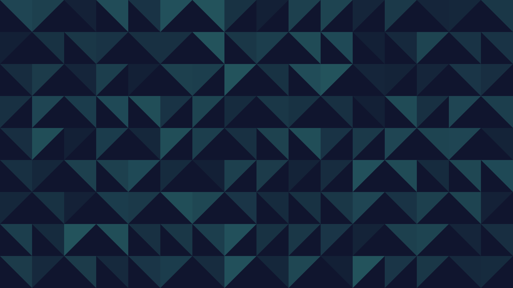
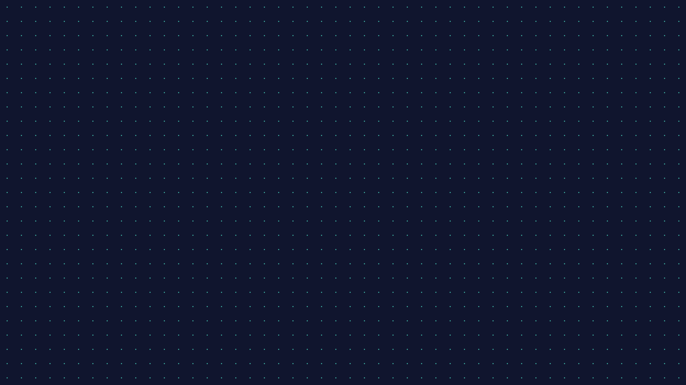
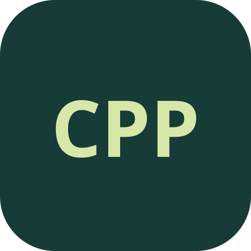
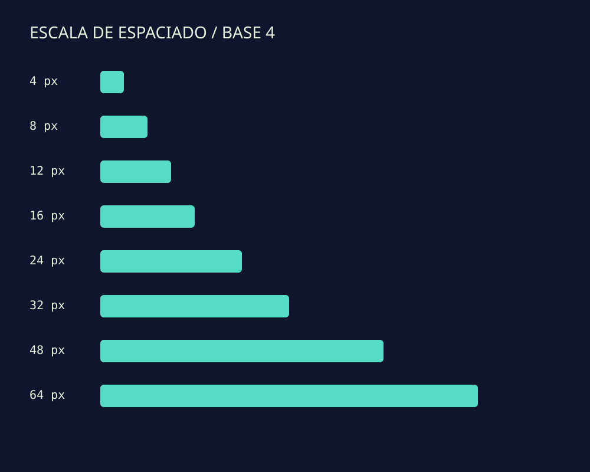

# Ejemplos generados por el ejecutable C++

## Degradado

## Mosaico

## Puntos

## Monograma

## Espaciado

[Paleta CSS](tonos.css) · [Galería HTML autónoma](galeria.html).

Las imágenes de la galería son material sintético de prueba. Los recursos no
cambian el escritorio ni incluyen archivos personales.
